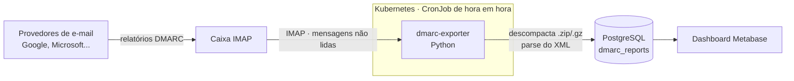
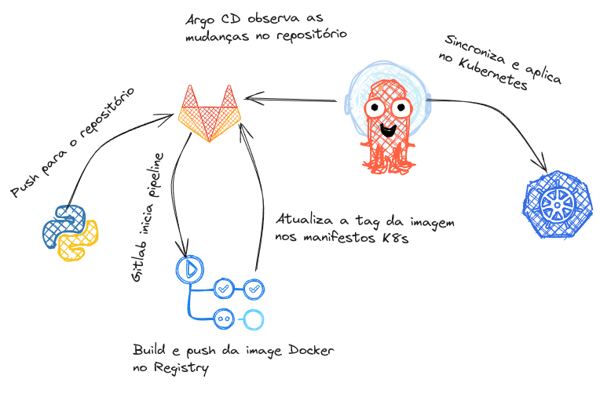
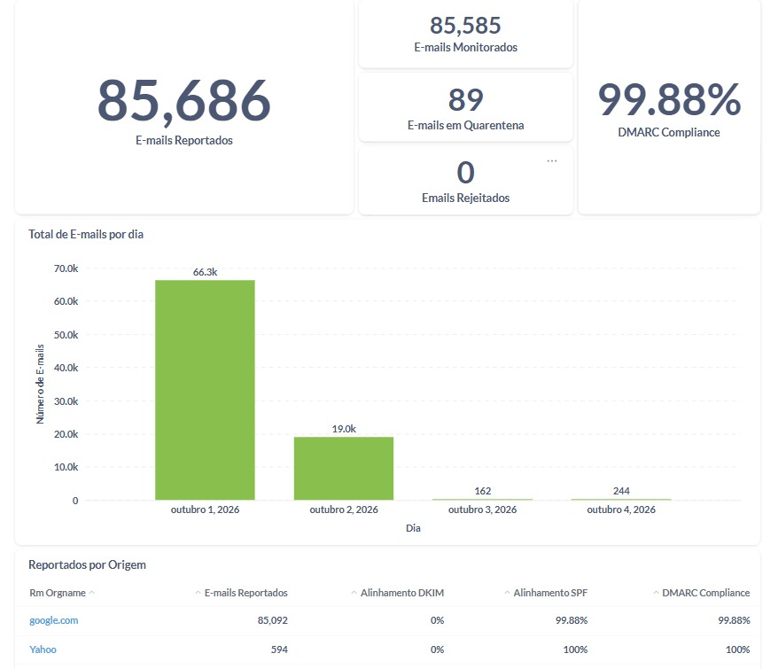

# dmarc-exporter

[](https://github.com/IgMnT/dmarc-exporter/actions/workflows/ci.yml)

Pipeline que coleta relatórios DMARC recebidos por e-mail, extrai os dados do XML e grava em PostgreSQL para análise em dashboard. Roda como CronJob no Kubernetes, com entrega contínua via GitLab CI e Argo CD.

> Projeto desenvolvido durante meu estágio em infraestrutura de TI no setor público. Esta é uma versão sanitizada: servidores, registry, repositórios e segredos foram substituídos por placeholders.

## O problema

Provedores como Google e Microsoft enviam diariamente relatórios DMARC agregados (XML compactado) para o domínio de e-mail da organização. Eles mostram quem está enviando e-mail em nome do domínio e se as mensagens passam em SPF e DKIM — essencial para detectar spoofing e ajustar a política de e-mail.

Lidos manualmente, esses anexos são inviáveis: centenas de arquivos `.zip`/`.gz` em XML. As ferramentas comerciais de análise são pagas.

## A solução



1. A cada hora, o job conecta via IMAP e busca as mensagens não lidas.
2. Baixa os anexos, descompacta `.zip` ou `.gz` e faz o parse do XML no padrão DMARC (RFC 7489).
3. Cada registro vira uma linha com metadados do relatório, política publicada (`p`, `sp`, `adkim`, `aspf`, `pct`), IP de origem, volume e resultados de SPF e DKIM. Relatórios já importados (mesma organização e `report_id`) são ignorados, então reprocessar a caixa é seguro; cada execução usa uma única conexão ao banco e insere cada relatório em lote.
4. Os dados alimentam um dashboard no Metabase, alternativa gratuita às ferramentas pagas de DMARC.

## Entrega contínua (GitOps)



- **GitLab CI:** build da imagem, push para o registry com tag por commit e atualização da tag nos manifestos via Kustomize.
- **Argo CD:** observa o repositório e sincroniza o CronJob no cluster, com overlays separados para `staging` e `prod`.
- **Sealed Secrets:** credenciais de e-mail e banco vão para o Git apenas criptografadas.

## Stack

Python 3.12 · imaplib · ElementTree · psycopg2 · PostgreSQL · Docker · Kubernetes (CronJob) · Kustomize · Argo CD · Sealed Secrets · GitLab CI · Metabase

## Como rodar localmente

```bash
cp .env.example .env   # preencha servidor IMAP, usuário, senha e dados do banco
docker compose up --build
```

O script processa as mensagens não lidas da caixa configurada e encerra. Para reprocessar, `mark_unread_zimbra.py` marca as mensagens da pasta como não lidas.

Testes do parser e da deduplicação, com um relatório de exemplo em `tests/fixtures/` (o `psycopg2` compila a partir do código-fonte e precisa do `libpq-dev`):

```bash
pip install -r requirements-dev.txt
pytest tests/
```

### Gerando os segredos para o Kubernetes

```bash
K8S_ENVIRONMENT=staging
kubectl create secret -n ${K8S_ENVIRONMENT}-dmarc-exporter generic dmarc-exporter-secret \
  --dry-run=client --from-env-file=.env.${K8S_ENVIRONMENT} -o yaml | \
kubeseal --controller-name=sealed-secrets-controller --controller-namespace=sealed-secrets \
  --format yaml > k8s/overlays/${K8S_ENVIRONMENT}/dmarc-exporter-sealedsecret.yaml
```

Depois, descomente a linha do SealedSecret em `k8s/overlays/staging/kustomization.yaml`.

## Resultados

Em produção, alimentando um painel no Metabase. Recorte de 1º a 4 de outubro de 2026:



- **85.686 e-mails** reportados em 4 dias por Google e Yahoo, com **99,88% de conformidade DMARC**.
- **89 mensagens em quarentena** e nenhuma rejeitada: o domínio já opera com política `quarantine`.
- O painel expôs um ponto de ajuste: **alinhamento DKIM de 0%**. A conformidade dependia só do SPF, o que orienta a configuração de assinatura DKIM antes de endurecer a política para `reject`.
- Visibilidade sobre quem envia e-mail em nome do domínio, sem custo de licença, rodando na infraestrutura existente.

## Próximos passos

- Marcar a mensagem como lida só depois de gravar o relatório (hoje o `FETCH` já a marca, e uma falha no meio perde o relatório até um reprocessamento manual)
- Mover a criação da tabela para migrações versionadas
